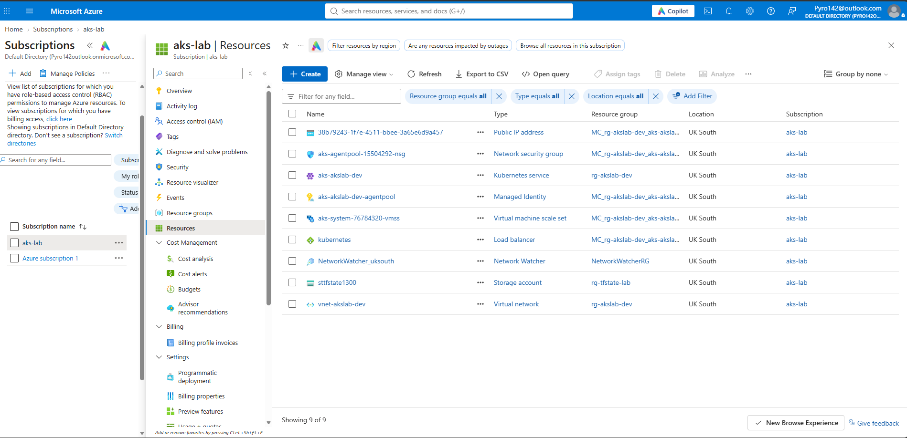
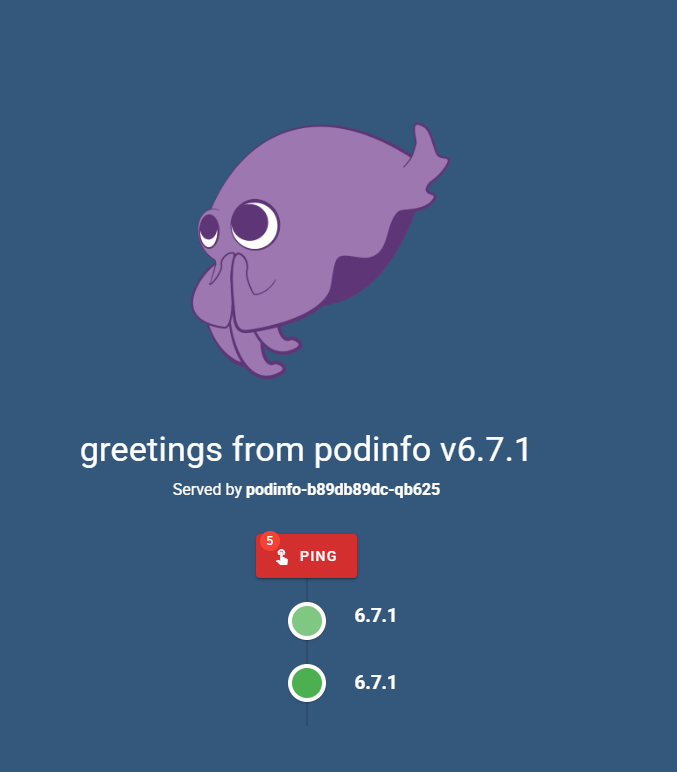
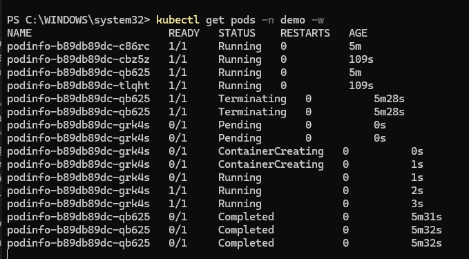
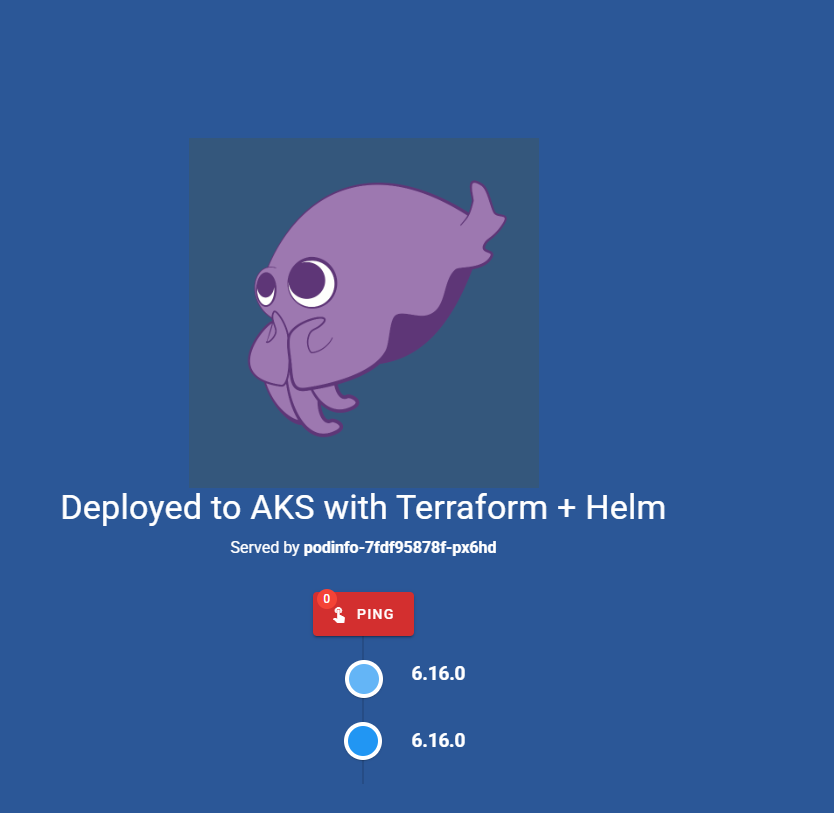
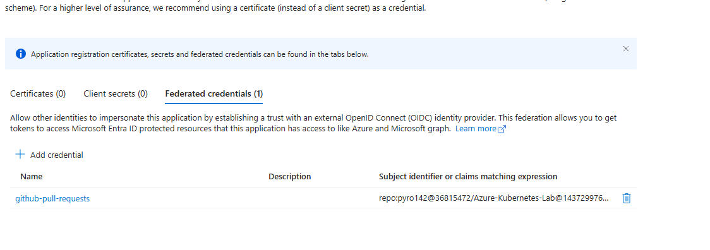
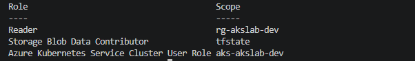
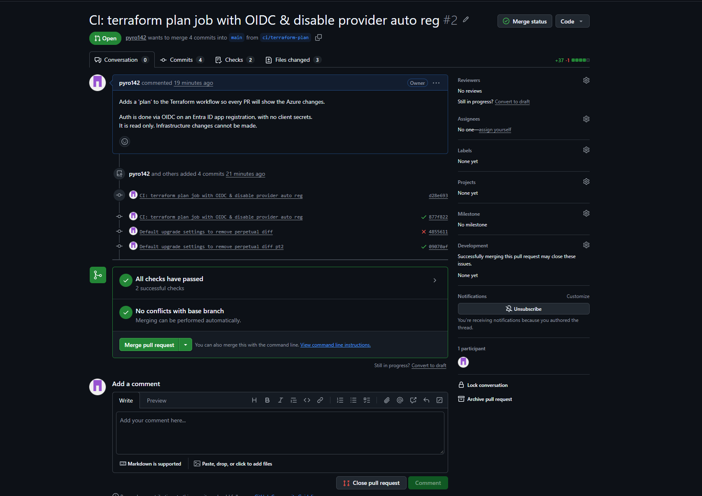
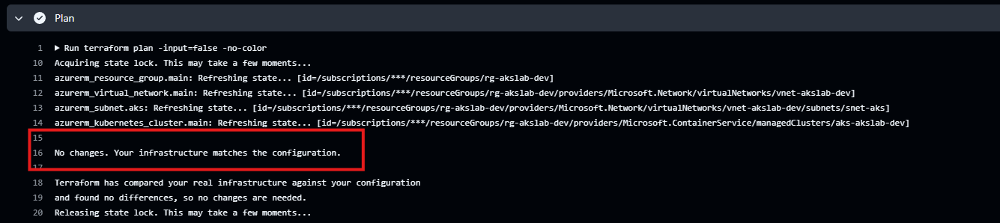

# AKS on Azure with Terraform, Helm and GitHub Actions
Lab environment for Azure Kubernetes, Helm, Terraform &amp; GitHub Actions

My background is Entra ID, Azure administration, Intune and PowerShell / Graph automation. AKS, Terraform and Helm aren't used where I work, so I built this lab to get hands-on with them before an interview for a Cloud Engineer role.

I used Terraform to build a Kubernetes cluster in Azure, deployed an app to it with Helm, and set up GitHub Actions to check every change automatically. It wasn't smooth sailing the whole way though.

## Summary

- **Terraform** deploys a resource group, VNet, subnet and a small **AKS cluster** (free tier, 1 node). I stored the state remotely in Azure Storage using my Entra login rather than a storage account key.
- **Kubernetes:** I deployed podinfo twice: first with plain manifests so I understood the basics, then with a **Helm chart** and my own `values.yaml`. I manually scaled it, deleted a pod to see the self-healing, checked logs, and did a Helm upgrade and a one command rollback to see what Helm was about.
- **GitHub Actions** runs `fmt`, `validate` and `plan` on every PR. It logs in to Azure with **OIDC, so there are no secrets stored anywhere**, and the pipeline only has the access it needs. On its first run it caught a real problem in my code, which I fixed.
- **Problems along the way:** VM quota, AKS supported VM sizes, a plan file committed by mistake, an OIDC subject mismatch, and missing permissions for the pipeline.

### Where I started

- **Terraform:** I'd only used it briefly in my home lab, and not for a production deployment.
- **Kubernetes:** I get the premise and why it's useful, but it isn't used in my current workplace, so my exposure was limited to single containers in my home lab.
- **Helm:** No prior knowledge

## What I learned

- How Terraform plans and applies changes, and why its state file needs protecting.
- That a VM size has to be allowed by AKS before you can use it.
- How Kubernetes keeps apps running by replacing pods itself.
- What Helm is, and how it makes upgrades and rollbacks one command.
- How to let GitHub log in to Azure with no stored secrets, and give it only the access it needs.
---

## What's in the repo

```
- bootstrap-state.ps1 – creates the storage for Terraform's state (run once)
- terraform/providers.tf – provider version and where state is stored
- terraform/variables.tf – inputs, like a PowerShell param() block
- terraform/main.tf – RG, VNet, subnet and AKS
- kubernetes/ – plain manifests: namespace, deployment, service
- helm/values.yaml – my overrides for the public podinfo chart
- .github/workflows/terraform.yaml – CI: fmt, validate and plan on PRs
- docs/images/ – screenshots
```

---

## 1. Building the infrastructure with Terraform

Terraform needs somewhere to keep its state, but it can't create the storage it keeps its own state in. So my bootstrap script (`bootstrap-state.ps1`) creates the storage account once with the az CLI, in its own resource group so that destroying the lab never deletes the state. I've worked in the AZ CLI whilst stufying for the AZ104, but day to day I'd normally use the Portal. Now that it’s scripted with variables, it’s easily and quickly repeatable, and the variables can be adjusted when it’s run.

I ran `fmt` and `validate` after every change and reviewed the plan before every apply:

```text
Plan: 4 to add, 0 to change, 0 to destroy.
```



AKS creates its own `MC_` resource group for the node VMs, load balancer and public IP. Azure also created `NetworkWatcherRG` on its own when I made the VNet. Terraform didn't create it, so it won't delete it either, and I clean it up by hand at the end.

## 2. Kubernetes with kubectl

```text
PS> kubectl get nodes
NAME                             STATUS   ROLES    AGE   VERSION
aks-system-76784320-vmss000000   Ready    <none>   10m   v1.36.5
```

I deployed podinfo with plain YAML: a Deployment and a Service. The nature of K8s means that pods come and go therefore their IPs change, so you never point traffic at a pod directly. The Service gives the app a stable address and spreads traffic across whichever pods are running. Because I used `type: LoadBalancer`, AKS created the Azure public IP for me.



**Scaling:** I scaled the pods manually from 2 to 4 with one command:

```text
PS> kubectl get deployment podinfo -n demo
NAME      READY   UP-TO-DATE   AVAILABLE   AGE
podinfo   4/4     4            4           3m44s
```

That's manual scaling. In production I'd use autoscaling. `kubectl scale` only changes the live cluster: my YAML in Git still says 2, so re applying or redepoying it would scale back down.

**Self healing:** I deleted a pod and got to see it happen live. Kubernetes noticed it had 3 pods instead of 4 and started a replacement straight away. The new pod was ready in about 2 seconds, before the old one had even finished shutting down.



## 3. Helm

It packages all the YAML for an app into a 'chart', and you only override the settings you care about. My `values.yaml` has five overrides; everything else comes from the chart's defaults.
This time, I have a custom color set, and a different version.

I installed an older version on purpose to test it, then upgraded, then rolled back. The rollback was fast, just one command, and I can see the history Helm keeps:



```text
PS> helm history podinfo -n demo
REVISION  STATUS      CHART           APP VERSION  DESCRIPTION
1         superseded  podinfo-6.16.0  6.16.0       Install complete
2         superseded  podinfo-6.17.0  6.17.0       Upgrade complete
3         deployed    podinfo-6.16.0  6.16.0       Rollback to 1
```

## 4. CI with GitHub Actions

Here's the idea of my basic GH Action. Every PR that touches my Terraform files runs **Format and validate**, then **Plan** if that passes. There's no `apply` in the pipeline, it just shows what would change.

For the plan to work, GitHub needs to log in to Azure. I'd usually create app registrations in the Portal, but sticking with the theme of the project I created it with PowerShell. Instead of a client secret, it has a **federated credential**: Entra trusts tokens from GitHub Actions, but only for pull requests from this repo. The workflow reads the IDs from GitHub secrets and swaps GitHub's token for a short-lived Azure one. There's no password to leak or rotate.



The pipeline only gets the access it needs, each at the narrowest scope:





**It caught something on its first run.** The plan wanted to change my AKS cluster even though nobody had touched it. A bit of research suggested 'perpetual diff'. AKS had added default upgrade settings that my code didn't mention, so Terraform kept trying to remove them. I fixed it by adding those defaults to my code, and the plan went clean:



---

## Decisions I made

| Decision | Why |
|---|---|
| State in Azure Storage, in its own resource group | Shared, locked and versioned so that a `terraform destroy` doesn't affect it. |
| Entra login for state, not the account key | Identity based access instead of a key |
| Free tier, 1 node, 30 GB disk | Cheapest setup that works. |
| Standard naming (`rg-`, `vnet-`, `aks-`, `st`) | Anyone can tell what a resource is from its name. |
| OIDC for CI, no `apply` in CI | No secrets in the pipeline, and changes have to be done manually. |

## Problems I hit and how I fixed them

| Problem | What I did |
|---|---|
| Not enough vCPU quota for the B-series VMs | Checked my quota per VM family with `az vm list-usage` and picked a family I had quota for |
| AKS wouldn't allow a size I did have quota for | Learned AKS has its own list of allowed sizes. A size has to be available, have quota, **and** be on that list. `Standard_D2ls_v6` passed all three |
| A `tfplan` file got committed | Spotted it, removed it from Git, and added plan files and kubeconfig to `.gitignore`. After that i was more careful to use `git status` before every commit |
| OIDC login failed with a subject mismatch | GitHub now adds fixed IDs for my account and repo to its token, so I updated the federated credential to match |
| Pipeline got a 403 reading the cluster | Reading AKS also fetches its credentials, which Reader doesn't cover. I added the AKS Cluster User role on the cluster only |
| CI found a perpetual diff | Added AKS's default upgrade settings to my code |

---

## How to run it

**You'll need:** an Azure subscription, PowerShell, and `winget install` for `Microsoft.AzureCLI`, `Hashicorp.Terraform`, `Kubernetes.kubectl`, `Helm.Helm` and `Git.Git`.

> **Cost:** a few pence an hour while it's running. Set a budget alert first, and tear it down when you're done.

```powershell
az login
$env:ARM_SUBSCRIPTION_ID = az account show --query id -o tsv

# 1. Create the state storage (once), then put its name in terraform/providers.tf
./bootstrap-state.ps1

# 2. Build the infrastructure
cd terraform
terraform init
terraform plan -out tfplan
terraform apply tfplan

# 3. Connect to the cluster
az aks get-credentials --resource-group rg-akslab-dev --name aks-akslab-dev
kubectl get nodes

# 4a. Deploy with plain manifests
kubectl apply -f ../kubernetes/

# 4b. Or deploy with Helm
helm repo add podinfo https://stefanprodan.github.io/podinfo
helm upgrade --install podinfo podinfo/podinfo --version 6.16.0 --namespace demo --create-namespace -f ../helm/values.yaml
```

Check the VM size in `variables.tf` against your own quota and the AKS-supported sizes first. It caught me out.

## Tearing it down

```powershell
# Remove the app first (this releases its public IP)
helm uninstall podinfo -n demo
kubectl delete namespace demo

# Destroy everything Terraform built (the MC_ group goes with the cluster)
cd terraform
terraform plan -destroy -out destroy.tfplan
terraform apply destroy.tfplan

# Things Terraform didn't create
az group delete --name NetworkWatcherRG --yes
az group delete --name rg-tfstate-lab --yes
az ad app delete --id <app-client-id>
kubectl config delete-context aks-akslab-dev

# Check nothing is left
az group list -o table
```

## What I'd do next

- **Production setup:** Standard tier, nodes across availability zones, separate node pools for system and app workloads.
- **Autoscaling** for pods (HPA) and nodes (cluster autoscaler).
- **A rule on `main`** so PRs can't be merged unless the checks pass.
- **An ingress controller with TLS** instead of a public IP per app, **Key Vault** for secrets, and a private cluster.